# Flujos operativos

Fecha: 14 de octubre de 2026  
Estado: propuesta. Estos flujos no están implementados. El Sprint 1 solo cubre el acceso.

## Atención presencial

```text
Operador inicia sesión
  -> Nuevo pedido
  -> Cliente mínimo
  -> Productos y cantidades
  -> Modalidad presencial
  -> Confirma el resumen
  -> Preparación
  -> Entrega en tienda
  -> Pedido cerrado
```

No se asigna transportista. No se abre un mapa.

## Entrega a domicilio

```text
Operador inicia sesión
  -> Nuevo pedido
  -> Cliente, dirección y referencia
  -> Productos y cantidades
  -> Modalidad domicilio
  -> Confirma el resumen
  -> Preparación
  -> Listo para despacho
  -> Un usuario autorizado asigna un transportista activo
  -> El transportista abre la ruta en una aplicación externa
  -> Registra entrega o intento fallido con motivo
  -> Pedido cerrado o pendiente de decisión
```

Un pedido a domicilio no se asigna antes de estar listo, salvo una excepción que todavía no existe.

## Datos mínimos

- Presencial: nombre de contacto y al menos un producto con cantidad válida.
- Domicilio: además, teléfono, dirección y una referencia.

El identificador del pedido, el estado inicial, el autor y el total los fija el servidor cuando ese módulo exista. El cliente móvil no será la autoridad.

## Excepciones todavía abiertas

- Producto no disponible y sustituciones.
- Cancelación: quién, hasta qué estado y con qué motivo.
- Entrega fallida: reintento, devolución o reasignación.
- Pedido duplicado por un reintento de red.
- Dirección incompleta o no verificable.
- Dos personas modificando el mismo pedido.

```mermaid
flowchart TD
  inicio[Pedido confirmado] --> modalidad{Modalidad}
  modalidad -->|Presencial| prepP[Preparación]
  prepP --> listoP[Listo para atención]
  listoP --> cerrado[Cerrado en tienda]
  modalidad -->|Domicilio| prepD[Preparación]
  prepD --> despacho[Listo para despacho]
  despacho --> asignado[Transportista asignado]
  asignado --> ruta[Navegación externa]
  ruta --> resultado{Resultado}
  resultado -->|Entregado| cerradoD[Cerrado]
  resultado -->|Fallido| decision[Decisión operativa pendiente]
```


